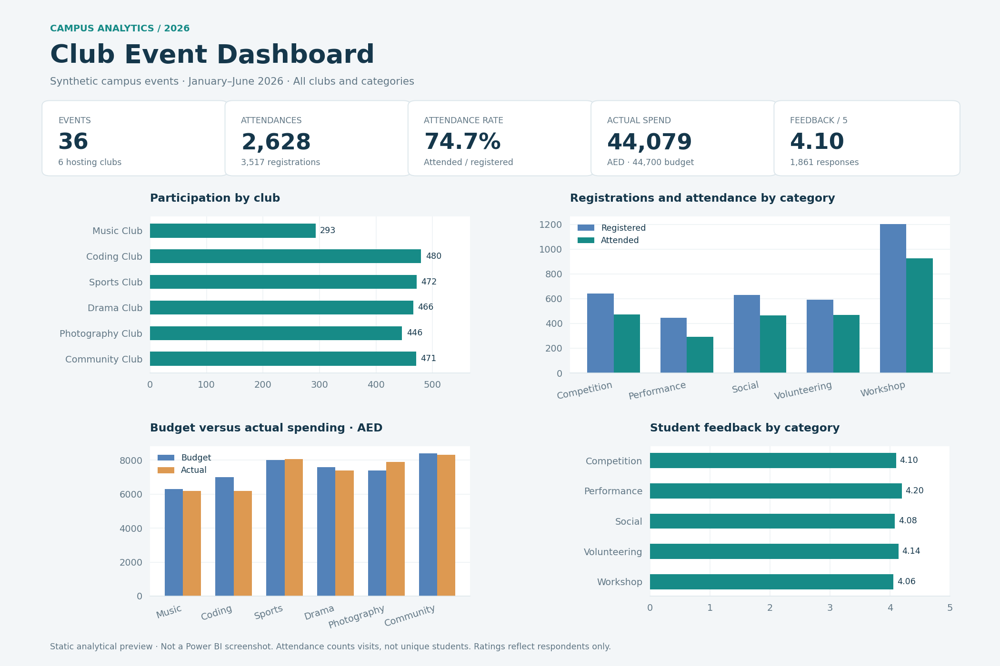

# Campus Club Event Dashboard

An Excel and Power BI portfolio project exploring club participation, attendance conversion, event budgets and student feedback using **synthetic campus event data**.

*The image is a generated analytical preview from the dataset, not a screenshot captured in Power BI. An interactive browser companion is included.*

## Open the dashboard
**Instant preview:** download/extract this repository and double-click `index.html`. It works offline, without installation or external libraries. Filter by club, category and date, inspect the charts, and sort event details.

**Power BI:** open `powerbi/Campus.pbip` in a current Power BI Desktop version on Windows. Alternatively open `powerbi/Campus.Report/definition.pbir`. Keep the entire powerbi folder together. Click **Refresh** to load the embedded sample data, then save. If required by your Desktop version, enable the Power BI Project/enhanced report format features under Options > Preview features and restart.

The source package contains a semantic model, 12 DAX measures and two report pages with 17 visual definitions. It is supplied as **PBIP/PBIR source, not a .pbix binary**. Desktop opening, rendering and DAX/M execution have not been tested in this environment. Browser logic/data checks and structural report validation are documented in `docs/VALIDATION.md`.

## Questions addressed
- Which hosting clubs attract the most event attendance?
- What proportion of registrations convert to attendance?
- Which events and clubs overspend?
- How does respondent feedback vary across event categories?

## Dataset
36 completed fictional events, six clubs and five event categories, January–June 2026. All budgets and costs are in AED. One row represents one event.

The raw input includes one duplicate row, three club labels with extra spaces and three lowercase category labels. The clean dataset has 36 unique event IDs. No personal student records are included.

## Results
| Metric | Result |
|---|---:|
| Events | 36 |
| Hosting clubs | 6 |
| Registrations | 3,517 |
| Event attendances | 2,628 |
| Registration-to-attendance rate | 74.7% |
| Planned budget | AED 44,700 |
| Actual spending | AED 44,079 |
| Net budget remaining | AED 621 |
| Average feedback | 4.10 / 5 |
| Feedback responses | 1,861 |

### Findings and possible next steps
- **Volunteering** has the highest category turnout rate at 79.3%; **Performance** has the lowest at 65.5%. A coordinator could investigate scheduling and registration reminders for low-turnout events.
- Overall spending is AED 621 below budget, but **18 of 36 events overspent**. Net budget performance alone conceals event-level overruns.
- Feedback averages 4.10/5 among respondents. Compare ratings alongside response counts before deciding which formats to repeat.

These are descriptive findings from synthetic data. The project does not demonstrate real-world cost savings, improved engagement or a causal effect of event category.

## Preparation and architecture
- `data/campus_events_clean.xlsx`: formatted Excel workbook with a clean Events table and preserved Raw sheet.
- `data/campus_events_raw.csv`: original synthetic input.
- `data/campus_events_clean_reference.csv` and `data/events.json`: cleaned reference data.
- `powerbi/Campus.SemanticModel`: import model and DAX measures.
- `powerbi/Campus.Report`: Overview and Event Details pages with cards, charts, slicers and a table.
- `index.html`: standalone browser companion.
- `docs`: formulas, Power Query source, metric definitions and validation notes.
- `BEGINNER_TUTORIAL.md`: rebuild walkthrough for learning.

The workbook was generated from the documented cleaning rules. The Power BI model embeds the **raw CSV snapshot** and repeats the cleaning in Power Query for a portable first refresh, avoiding machine-specific file paths. It is not linked live to the Excel workbook. The browser companion embeds the clean snapshot. Changing the workbook will not automatically change either dashboard.

To connect the Power BI model to your edited workbook later, use the replacement query in `docs/CONNECT_EXCEL.md`. To rebuild the browser companion from the raw CSV, run `python scripts/refresh_browser.py` from the repository root.

## Definitions and limitations
- Attendance rate = total attendees / total registrations.
- Budget remaining = total budget − total actual cost; negative indicates overspending.
- Average feedback = total feedback points / total feedback responses.
- Cost per attendance = total actual cost / total attendees.
- Rates and feedback are calculated from matching totals, not averages of event-level ratios.
- Event attendances are visits, not distinct students or club members.
- Every attendee is assumed to have registered; no walk-ins. Each respondent submits one rating from 1 to 5.
- Most categories correspond to one club, so club effects cannot be separated from category effects.
- Feedback excludes nonrespondents and may be biased.

## Uploading this project
Create a GitHub repository named `campus-club-event-dashboard`, select **Add file > Upload files**, and upload this extracted folder's **contents**, preserving subfolders. Put README.md at the repository root. Commit the files.

The repository preview uses the included PNG. GitHub does not run the HTML or display an interactive Power BI report in its normal file viewer. Download and open index.html locally, or configure GitHub Pages separately if you later want a hosted browser demo.

## Learning
The project files were prepared with AI assistance. Use the tutorial to rebuild the workflow and verify it in Power BI Desktop before describing the implementation as independently completed.

## References
- [Power BI projects](https://learn.microsoft.com/en-us/power-bi/developer/projects/projects-overview)
- [Power BI report format](https://learn.microsoft.com/en-us/power-bi/developer/projects/projects-report)
- [Power BI semantic model format](https://learn.microsoft.com/en-us/power-bi/developer/projects/projects-dataset)

